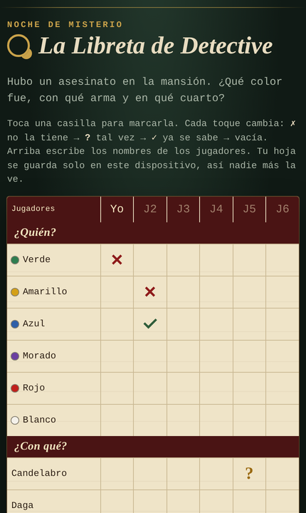

# La Libreta de Detective 🔍

A digital notebook for mystery deduction board games. Track suspects, weapons and rooms from your phone instead of on paper.

👉 **Use it here:** https://arichaves.github.io/la-libreta-de-detective/

📱 **Android app (APK):** [download the latest version](https://github.com/AriChaves/la-libreta-de-detective/releases/latest)

## Features

- **Full deduction grid**: 6 suspects, 6 weapons and 9 rooms across up to 6 players.
- **One-tap marking**: each tap cycles a cell through ✗ *doesn't have it* → ? *maybe* → ✓ *confirmed* → empty.
- **Player names**: editable column headers, so you know whose card is whose.
- **Three languages**: Spanish, English and Portuguese, picked from the phone's language and switchable with the ES · EN · PT buttons (also `?lang=es`, `?lang=en`, `?lang=pt`). Switching keeps your marks.
- **Private by design**: your sheet is saved only on your device (`localStorage`), with no accounts, no ads and no server.
- **Installable app**: an "Install app" button on Android and computers, and "Share → Add to Home Screen" on iPhone. It opens full screen with its own icon.
- **Works offline**: the Android app works with no internet at all, and the web version keeps working offline after the first visit.
- **Mobile-first and accessible**: responsive down to 320px, sticky headers, 16px inputs to prevent iOS zoom, keyboard focus states and screen-reader labels.
- **Safe reset**: "New game" asks for a second tap before clearing the sheet, and it keeps the player names.

## Use

Open https://arichaves.github.io/la-libreta-de-detective/ on your phone or computer and add it to your home screen, or install the Android APK from [Releases](https://github.com/AriChaves/la-libreta-de-detective/releases/latest). Android will ask you to allow installing apps from this source the first time.

## En español

Hoja de detective gratis para juegos de deducción como Clue o Cluedo: ¿quién fue, con qué arma y en qué cuarto? Toca una casilla para marcar ✗ / ? / ✓, hasta 6 jugadores, y tu hoja se guarda solo en tu dispositivo. Funciona en el navegador del celular, sin cuenta. También hay app para Android (APK) en [Releases](https://github.com/AriChaves/la-libreta-de-detective/releases/latest).

## Em português

Folha de detetive grátis para jogos de dedução como Detetive, Clue ou Cluedo. Toque numa casa para marcar ✗ / ? / ✓, até 6 jogadores, e suas anotações ficam só no seu aparelho. Funciona no navegador do celular, sem conta. Também tem app para Android (APK) em [Releases](https://github.com/AriChaves/la-libreta-de-detective/releases/latest).

---

This repository holds the published build only. Independent free project, not affiliated with Hasbro. Clue and Cluedo are trademarks of their owners.

Made by [Arianna Chaves](https://www.linkedin.com/in/arianna-chaves-304a031b9)
